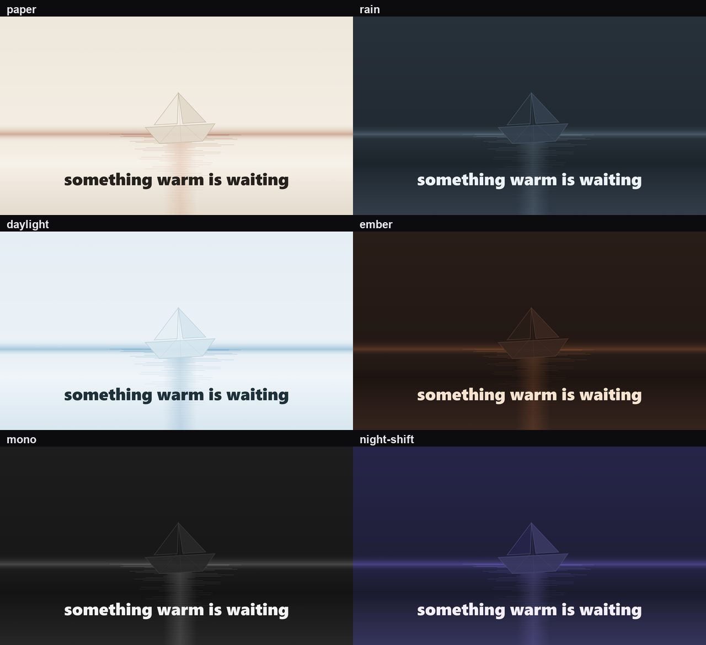
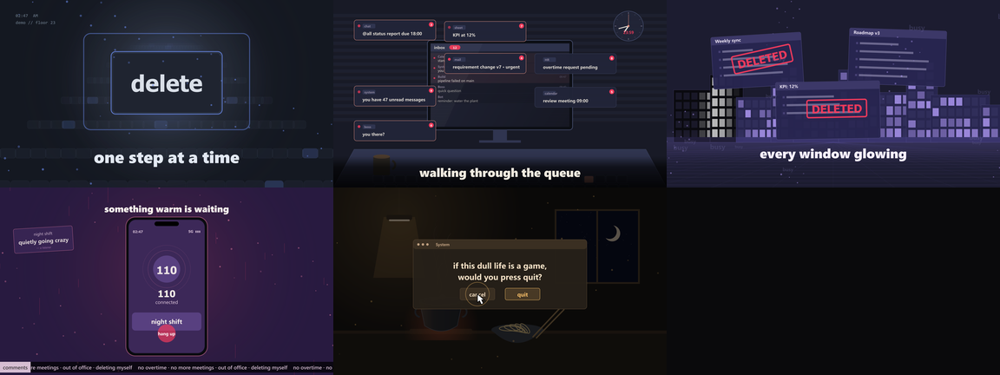

# song-mv

**English** · [简体中文](README.zh-CN.md)

给它一首歌和一份 `.lrc`，它逐帧画出踩点的画面。歌词当字体动画来画，而不是塞在底部字幕条里。

片子长什么样是你定的，不是继承来的默认值。**look（色世界）**决定整片的气质，一组**图元**搭出这首歌需要的画面，而每个镜头都必须声明**运镜**和**事件**——所以它动起来像片子，不像一张会呼吸的海报。

唱纸船的歌拿到纸、雨，和一条横穿画面的纸船；不会拿到一间办公室。



*同一个 `field`/`water` 镜头、同一句词，换六个 look。变的只有色世界。*

两种用法：装成 DSH 插件，之后直接在 DSH 里让 agent 出片；或者当命令行用，自己敲。

```
song  ─▶ analyze ─▶ features.json ─┐
                                   ├─▶ render ─▶ 原始帧 ─(管道)─▶ ffmpeg ─▶ .mp4
storyboard.json ───────────────────┘                              ▲
lyrics.lrc ─────────────────────────────────────────────────────────┘
```

**[▶ 54 秒 demo（webm，无声）](docs/demo/demo.webm)** · [九宫格预览](docs/demo/contact-sheet.png)



*上面的帧都来自 demo，每一个像素都是代码画的：没有素材、没有图片、没有内置字体。音频由 ffmpeg 合成，歌词是为这个仓库写的——见 [`examples/synthetic-demo`](examples/synthetic-demo)。*

关于那首测试曲：这套引擎是对着一首商业歌曲（我自己在网易云买的）和它的 `.lrc` 调出来的。那首歌的音频、它的歌词、以及由它渲出来的视频都不在本仓库里。这里留下的是引擎、分镜格式和上面那份合成 demo。

一帧就是一个关于时间的纯函数。`renderFrame(t)` 每次跑出来的像素完全一样，所以改一行、重渲、diff 是可行的。

## 一个镜头 = 运镜 + 事件

相机是包在场景外面的，所以没有任何一个场景会「静止地」渲染出来。每个镜头在分镜里选一个动作：

```json
{ "id": "03_sink", "start": 43.4, "end": 72.0,
  "palette": "build", "camera": "push", "cameraAmount": 0.09, "handheld": 1.4,
  "scene": { "type": "field", "params": {
    "layer": "water", "horizon": 560,
    "motif": "boat", "motifAt": [1080, 600, 240],
    "travel": [-220, 0], "stage": "sink", "sinkAt": 0.5,
    "lyricStyle": "karaoke" } } }
```

运镜有 `push` `pull` `panL` `panR` `driftUp` `driftDown`。场景内部三层以不同速率平移形成视差，母题沿 `travel` 横穿画面，`stage` 给它一条弧线——`enter`、`drift`、`sink`、`return`——于是一首歌可以用一个主体讲完，而不是六张互不相关的画。踩点事件（涟漪、顿帧、镜头撞击）来自音频分析，不是手打的时间轴。细节见 `docs/motion.md`。

## 歌词是时间问题，不是文字问题

`.lrc` 带逐字标记（`[00:37.67]<00:37.67>把名字从手机里 <00:39.79>悄悄删掉了`）时，
卡拉 OK 填充跟着人声走；否则退化成固定阅读速度。

"歌词时间不对"多数是文件的问题，不是渲染器的问题。音乐平台常同时给
`song.lrc` 和 `song.std.lrc`，而 `.std` 是用每行**最后一个**字的时间戳生成的——
于是每行都晚，而且晚的量各不相同：

```
同一行                    逐字文件   .std     滞后
把名字从手机里 悄悄删掉了      37.67    43.42   +5.75 s
聊天记录停在最底下             28.61    29.85   +1.24 s
```

```bash
song-mv check-lyrics song.std.lrc --duration 200.9
# vs song.lrc: 49 matching lines, 49 stamped late, median lag 1.96s
```

`docs/lyrics.md` 里还有 offset 标签、行间距怎么读、以及什么情况下长间隔是源文件的锅。

## 写场景也是流水线的一步

通用场景能撑起一个镜头，撑不起一部片子。好 MV 的密度来自只对这首歌成立的东西。
所以写场景是流水线上的一个环节，按成本从低到高分三条路。

**1. 编排。** `designed` 接收三个景深平面，每个平面一串 actor，每个 actor 自带
入画、位移和下沉/回归，所以编排出来的镜头天生是会动的。

```json
{ "type": "designed", "params": {
    "layer": "water", "horizon": 560,
    "back": [{ "prop": "moon", "at": [1460, 250, 130], "enter": 0.6, "enterFrom": "above" }],
    "mid":  [{ "prop": "boat", "at": [1090, 590, 240], "travel": [-210, 26],
               "stage": "sink", "sinkAt": 0.82 }],
    "near": [{ "prop": "rain", "at": [960, 540, 1], "density": 120 }] } }
```

**2. 脚手架。** 需要现有道具画不出的画面时：

```bash
song-mv new-scene gutter --out scenes/gutter.mjs
```

生成的文件立刻能渲染，只要在分镜里加 `"scenes": ["scenes/gutter.mjs"]`。文件里
不需要 import：图元在 `ctx.lib`，缓动在 `ctx.mo`，运镜在 `ctx.cam`。

**3. 手写。** 值得的镜头就照契约 `(ctx, tv, f, P)` 自由写。

### 然后量一下它到底动没动

```bash
song-mv check-motion --storyboard storyboard.json --features data/features.json
```

每个镜头取八帧，按像素变化 + 暗部质心位移打分。低于 `1.0` 的会标 `← static`
并让命令失败。

```
shot                     type        len   score   pixels  shift  frames
03_sink                  field      28.6s    0.48     0.16    6.4  0/7  ← static
```

这是本仓库自己的片子里真实出现过的一行：那一帧当静帧看没问题，动起来什么也没发生。
给它加上推镜、下沉的小船和近景的雨之后，分数到了 `2.16`，每一对帧都变了。
完整流程见 `docs/scene-pipeline.md`。

## 两个决定

生成的 MV 出问题，几乎都出在这两步，所以 skill 会强制先把它们写下来，再动手写 JSON。

**一、色世界（look）。** 整片一个。

| look | 世界 | 适合唱什么的歌 |
|---|---|---|
| `paper` | 暖白、墨色、折痕 | 记忆、信、不舍 |
| `rain` | 湿冷的蓝灰、漫射光 | 失去、距离、深夜的城市 |
| `daylight` | 明亮中性、干净空气 | 希望、清晨、释怀 |
| `ember` | 深红棕、低照度 | 愤怒、灼烧、执念 |
| `mono` | 纯黑白 | 档案、克制的悲痛 |
| `night-shift` | 深蓝霓虹、屏幕 | 深夜加班、反讽、压抑 |

**二、画面清单。** 五到八个具体的东西，每一条都能对应到某句歌词。"纸船顺着雨水沟漂下去"是画面，"悲伤"不是。某一段实在没东西可拍，就回去重读那句词，而不是把上一首歌的场景搬过来。

调色板和新增色世界见 `docs/looks.md`；没有现成场景可放时，怎么写一个 25 行的场景见 `docs/writing-a-scene.md`。`examples/nine-shots` 里那九个办公室场景是某一首歌的道具，留作范例——见[关于那首测试曲](#关于那首测试曲)。

---

## 安装

### 前置条件（两个，都要你自己装）

| 依赖 | 版本 | 怎么装 |
|---|---|---|
| **Node.js** | ≥ 20.10 | [nodejs.org](https://nodejs.org/) 下 LTS 版 |
| **ffmpeg** | ≥ 6.0 | [ffmpeg.org/download.html](https://ffmpeg.org/download.html) 按系统下载，解压后把 `bin` 加进 `PATH` |

装完自检：

```bash
node -v          # v20.10 或更高
ffmpeg -version  # 能打印版本就行
```

ffmpeg 不随插件分发，也不会自动下载，这是故意的（原因见[授权](#授权)）。缺了它，`render` 会停下来告诉你去哪个网址装，而不是瞎猜。包里没有 postinstall，也没有二进制文件。

macOS / Linux 上如果 `npm install` 找不到 Cairo/Pango 头文件：

```bash
brew install pkg-config cairo pango libpng jpeg giflib librsvg
# 或
sudo apt install build-essential libcairo2-dev libpango1.0-dev libjpeg-dev libgif-dev librsvg2-dev
```

### 作为 DSH 插件安装

```bash
git clone <本仓库地址> dsh-song-mv
cd dsh-song-mv && npm install        # 拉 canvas，顺便验证能装上
dsh plugin --profile desktop add "link:/绝对/路径/dsh-song-mv"
# 重启 DSH 一次，bundle 层才会加载
```

重启后技能列表里会多出 `song-mv`，CLI 也在。这个技能带 agent 走：分析 → 读懂这首歌 → 起草分镜 → 渲静帧自检 → 全片渲染 → 验收。

**没有 `dsh` 命令？** 桌面版不一定把 CLI 放到 `PATH` 上，这挺常见。两条等效路线：

- 让 agent 帮你装：DSH 自带插件管理器，下面几个文件它也能直接改；
- 手动改 profile：把 `"dsh-song-mv": "link:/绝对/路径"` 加进 `~/.dsh/profiles/desktop/package.json` 的 `dependencies`，把 `"dsh-song-mv"` 加进同文件的 `dsh.profile.bundles`，在该目录跑 `pnpm install`，重启 DSH。逐步说明见 [docs/publishing.md](docs/publishing.md#5-installing-into-dsh)。

### 作为纯命令行使用

```bash
git clone <本仓库地址> dsh-song-mv
cd dsh-song-mv
npm install
node tools/cli.mjs help
```

装了插件之后下面的命令一样能跑，插件只是在上面多注册了一个 agent 技能。

---

## 五分钟上手

```bash
# 1. 解码 + 分析音频（ffmpeg 能读的格式都行）
node tools/analyze.mjs song.flac --out features.json
#    tempo 106.67 BPM · 5445 frames · 181.5s

# 2. 自动起草分镜（切点落在小节线上，场景按能量轮换）
#    --look 选色世界，--scenes generic 表示不套用任何一首歌专属的场景
node tools/plan.mjs --features features.json --out storyboard.json --shots 9 \
  --look paper --scenes generic

# 3. 手改 storyboard.json：填 lyricsFile，把占位参数换成这首歌真正的故事
#    场景参数见 docs/scenes.md

# 4. 先看静帧，再决定要不要花十分钟渲染
node tools/preview.mjs --storyboard storyboard.json --features features.json \
  --audio song.flac --out out/preview

# 5. 渲染
node tools/render.mjs --storyboard storyboard.json --features features.json \
  --audio song.flac --out out/mv.mp4 --crf 18

# 6. 验收
node tools/qa.mjs --file out/mv.mp4
```

3 分钟 1080p 的片子，普通笔记本上大约 25 fps：3.5 分钟出片，CRF 18 大约 57 MB。

### `analyze` 的参数

| 参数 | 含义 |
|---|---|
| `--fps 30` | 节拍网格的帧率（要能整除采样率） |
| `--bpm 106.67` | 你知道真实速度时直接给，能量投票分不清 80 和 160 |
| `--out features.json` | 分析结果写哪 |

速度检测会同时给出胜出的网格和 `tempoCandidates`（次优的节拍层级）。听着像半速是正常的，加 `--bpm` 就行。

---

## 分镜长什么样

```jsonc
{
  "title": "demo",
  "duration": 181.5,
  "lyricsFile": "lyrics.lrc",
  "post": { "scan": 0.03 },          // 扫描线
  "safety": { "maxFlash": 0.7 },     // 全屏闪白上限（防光敏）
  "look": "paper",                   // 整片的色世界
  "shots": [
    {
      "id": "05_water",
      "start": 95.1, "end": 119.8,
      "palette": "intense",          // still|tender|build|release|intense|peak|dawn|fade
      "enter": "cut",                // cut|dissolve|wipe|glitch
      "loud": true,                  // 踩拍时镜头推一下
      "scene": {
        "type": "field",
        "params": {
          "layer": "water",          // paper|water|rain|snow|ink|motes|thread|window
          "motif": "boat",           // boat|window|moon|lantern|chair|birds
          "motifAt": [980, 600, 180],
          "horizon": 640,
          "lyricY": 880
        }
      }
    }
  ]
}
```

几条要注意的：

- 镜头要无缝铺满时间轴。不能有空档、不能重叠，最后一个 `end` 等于歌曲时长。
- `palette` 是情绪状态，不是配色。look 把 `still`、`peak`、`dawn` 翻译成具体颜色：`peak` 就是这个色世界里最响的那一档。场景只读 `p.accent`、`p.text` 这类字段，换 look 等于整片换气。
- `enter` 是镜头怎么进来。`glitch` 留给鼓点砸下来的地方。
- 文案都在 `params` 里。demo 里出现的每一句话都写在它自己的分镜里，不在引擎里。`examples/generic-field/storyboard.json` 是能用任何歌跑的通用示例；`examples/nine-shots/storyboard.json` 是那首办公室的歌的完整九镜，看结构可以，别照着抄到别的歌上。

完整 schema 见 [docs/storyboard.md](docs/storyboard.md)，场景目录和每个参数见 [docs/scenes.md](docs/scenes.md)。

---

## 歌词

`lyricsFile` 指向标准 `.lrc`：

```
[00:00.50]one step at a time
[00:05.80]walking through the queue
[00:18.40]delete the noise
```

引擎按当前时间找到这一行，交给场景决定怎么出现：砸入、逐词弹跳、橡皮章、RGB 错位、卡拉 OK 填充、回声墙。没有时间戳的行会被忽略，所以给一份纯文本歌词，出来的就是没有歌词的视频。时间戳支持 1–3 位小数，各家编辑器写法不一样。

歌词是文字作品。没有授权就别把 `.lrc` 传上公网。

---

## 授权

代码是 MIT。仓库里没有什么，和有什么一样重要：

- 没有音乐、没有歌词、没有字体、没有 ffmpeg。四样都由你在运行时提供，`.gitignore` 拦着不让误提交。
- ffmpeg 是独立进程调用，不链接、不捆绑。按 GPL FAQ 这叫 mere aggregation：产出的视频归你，仓库不背 ffmpeg 的义务。
- 字体只按名字引用（`Inter`、`Microsoft YaHei`、`Noto Sans CJK`），实际渲染由操作系统提供。

如果你要分发打包产物（zip、Docker 镜像、单文件二进制）并把 `node_modules` 塞进去，那你就是发行者：`canvas` 内嵌 **Cairo（LGPL-2.1 / MPL-1.1）**，canvas v3 还有 **Pango（仅 LGPL）**。动手前先读 [THIRD-PARTY-NOTICES.md](THIRD-PARTY-NOTICES.md)。

这类项目真正的坑不在 MIT 依赖，在演示素材：一首商业歌曲、一个抓来的 `.lrc`、一个"就为跑个例子"提交的字体文件。所以 `examples/` 放的是分镜格式本身——带占位文案的镜头表——外加一个合成 demo，音频由 ffmpeg 生成、歌词为本仓库原创。

说具体点：本仓库没有已发行歌曲的录音，没有照抄来的 `.lrc`，也没有用它们渲染的视频。`examples/` 里的分镜描述的是镜头结构（时间、配色、场景类型），里面的字是为示例写的。分镜既不是录音也不是歌词本；但你要是把别人的歌词填进分镜再把成品发出去，那是你的选择，MIT 许可证不为此背书。

---

## 仓库结构

```
engine/
  core.mjs        调色板、Features（踩点采样）、Lyrics、画布上下文、后处理、createEngine
  scenes.mjs      9 个场景函数，签名统一 (ctx, tv, f, params)
  lyric_fx.mjs    歌词手法：slam / bounce / wall / sliced / karaoke / decode
  story_fx.mjs    故事道具：印章、跑马灯、电话、楼群、厨房、户型图、黑洞
  prng.mjs        带种子的随机（同种子 → 同一帧）
tools/
  analyze.mjs     ffmpeg 解码 → WAV → FFT → features.json
  plan.mjs        按能量曲线起草分镜
  preview.mjs     只渲几张静帧
  render.mjs      全片渲染，原始帧直接进 ffmpeg
  qa.mjs          亮度曲线 + 闪烁检测
  cli.mjs         统一入口
  lib/analyze.mjs 纯 JS 的 FFT / mel / 节拍网格（不用 Python，不用 librosa）
skills/song-mv/   给 agent 的工作流
examples/         分镜示例：nine-shots（完整九镜，占位文案）、synthetic-demo（全原创）
docs/             分镜 schema、场景目录、渲染模型、demo 素材
```

渲染模型为什么长这样，见 [docs/how-it-works.md](docs/how-it-works.md)。

---

## 常见问题

**为什么用 canvas 而不是浏览器？** 帧在无头环境生成，原始 RGBA 直接进 ffmpeg。没有页面加载、没有截图时序、没有 60fps 上限、不占 GPU，输出还是确定的。

**能加自己的场景吗？** 能。在 `engine/scenes.mjs` 里写 `export function myscene(ctx, tv, f, P)`，用 `ctx.g` 画、从 `ctx.pal` 取色、从 `lyricsOf(ctx).activeAt(tv)` 取歌词，注册到 `SCENES`，分镜里写 `"type": "myscene"`。

**第一帧为什么是黑的？** `dissolve` 和 `glitch` 都是从黑场淡入的。第一个镜头用 `"enter": "cut"`。

**我机器上渲染很慢。** canvas 是 CPU 渲染，1080p 本来就吃 CPU。迭代时用 `--fps 24`，或者 `--start 60 --end 90` 只渲一段。

**能放图片吗？** 在场景里 `canvas.loadImage()` 载入就行，记得先确认你有那张图的使用权。

---

## 许可

MIT © 2026 dsh-song-mv contributors。见 [LICENSE](LICENSE)。
